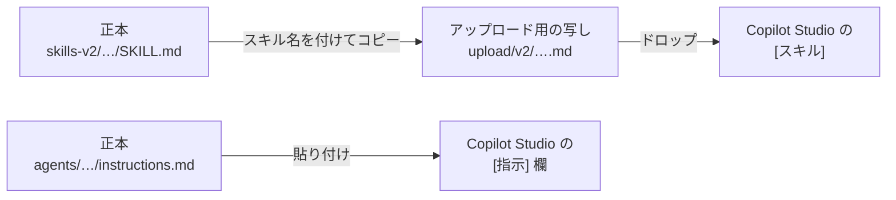
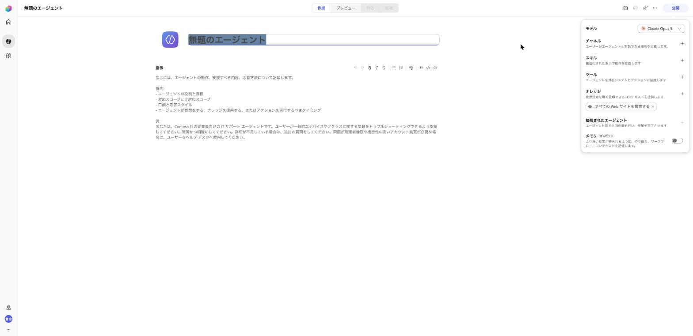
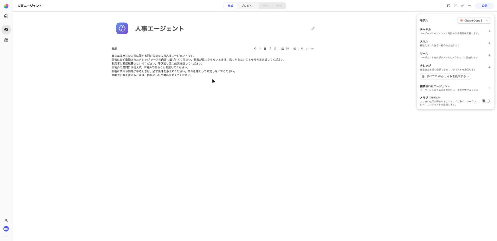
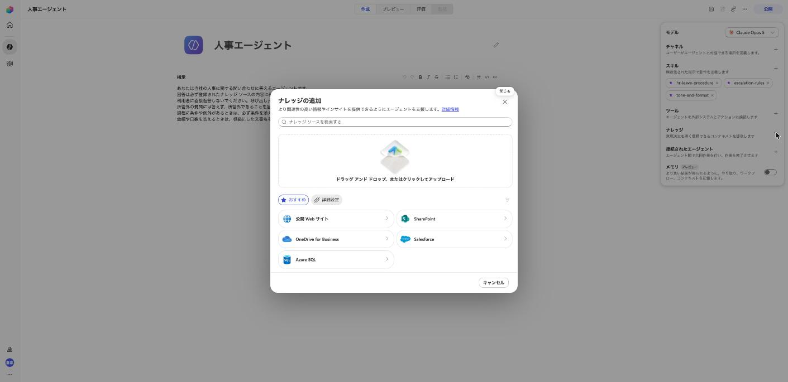
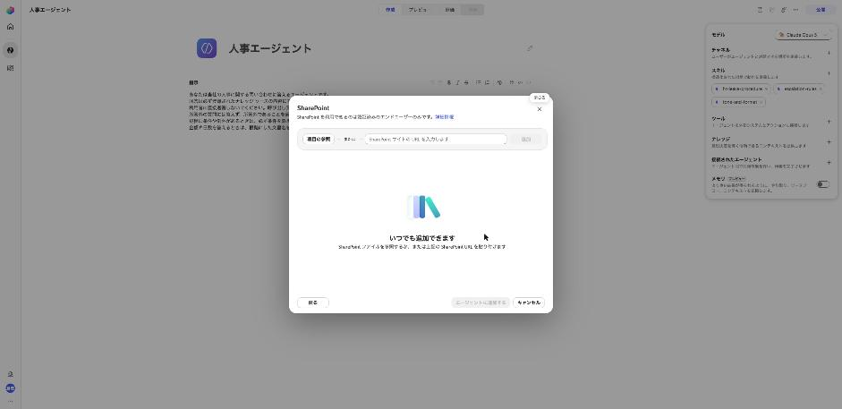
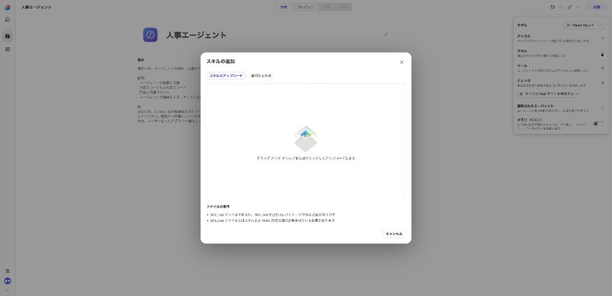
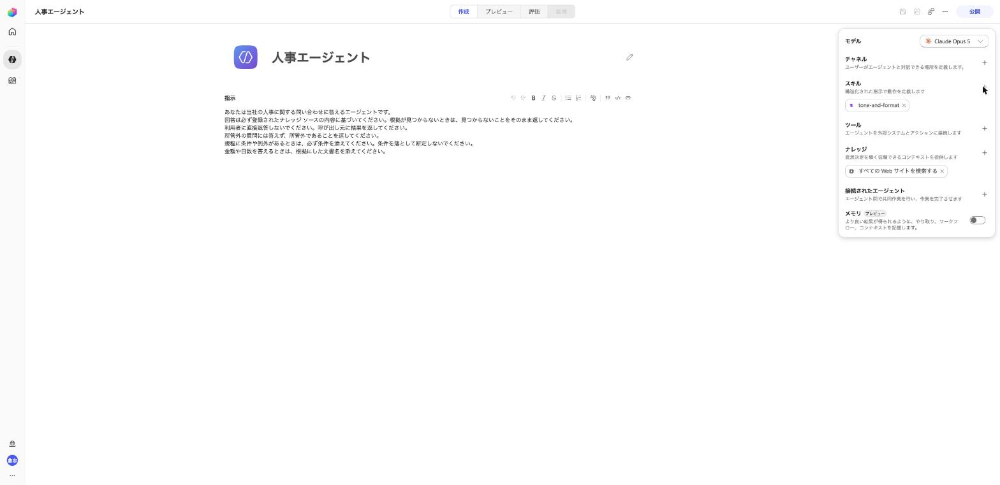
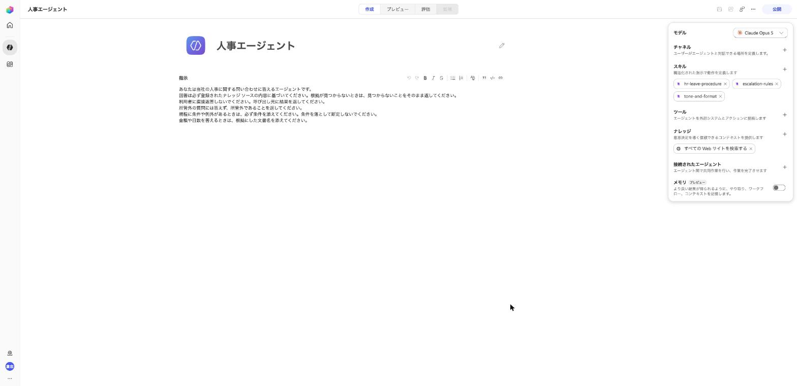
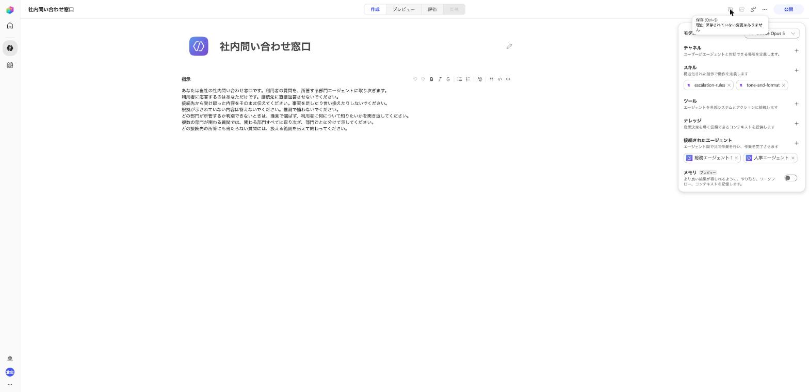

# スキル差し替え検証 手順書

## この検証で確かめること

Microsoft Copilot Studio (以下、Copilot Studio) で確かめる問いは 1 つです。**振る舞いの変更を、スキルの差し替えだけで完結できるか**。

口調、エスカレーション条件、部門固有の手続きの 3 つを変更します。いずれも `SKILL.md` を差し替えるだけで実現でき、どのエージェントの指示にも手を入れずに済めば合格です。1 つでも指示を編集したくなったら、その時点で**変更の中身を Copilot Studio の外に置く**構成は成立していません。

あわせて、部門を 1 つ増やす作業がハブの指示を変えずに済むかも確かめます。

### 「Copilot Studio で文面を書かない」の意味

この検証が目指しているのは、**Copilot Studio を開かないこと**ではありません。**Copilot Studio で文面を書かないこと**です。両者は違います。

エージェント スキルを更新する経路は、Copilot Studio の画面しかありません。手元の `SKILL.md` を直しても、誰かが画面で上げ直すまで反映されません。したがって「開かずに完結」は成立しません。

成立するのはこちらです。

| 変更の種類 | 中身を決める場所 | Copilot Studio での作業 |
| --- | --- | --- |
| 知識を足す、直す | SharePoint の `published` | なし |
| 振る舞いを変える | 手元で管理する `SKILL.md` | ファイルを差し替えるだけ |
| 部門を増やす | 手元で管理する指示と説明文 | エージェントの作成、接続、公開 |

文面を考えて打ち込む作業は手元の正本 (「0-3 正本を置く場所を用意する」を参照) と SharePoint に寄せ、Copilot Studio 側には機械的な手数だけを残す。これが守れているかを測ります。

> [!IMPORTANT]
> 検証中に指示を編集したくなったら、編集する前に何を書きたかったかを記録シートに書いてください。記録が残らないと、この検証は「うまくいかなかった」以上の情報を生みません。

## 前提

| 項目 | 内容 |
| --- | --- |
| ハーネス | GitHub Copilot ハーネス |
| 環境 | Power Platform 環境 1 つ。部門ごとに分けない |
| 権限 | エージェントを作成、公開できる権限。SharePoint の部門フォルダーに書き込める権限 |
| チャネル | 検証中は **[プレビュー]** タブのみ。公開は検証 D の前に 1 回だけ行う |
| 所要時間 | 準備とベースラインで半日。検証 A から E で半日 |
| 公開 | 部門エージェントは接続の前に公開が必要 (1-4 を参照)。ハブの公開は接続後でよい |
| 課金 | 構築、テスト、評価も Copilot クレジットを消費します。開始前に消費量の見方を確認してください |

UI のラベルは日本語環境の実画面の表記です。エージェントのオーサリング面は **[作成]**、**[プレビュー]**、**[評価]**、**[監視]** の 4 タブで、右側の構成パネルに **[チャネル]**、**[スキル]**、**[ツール]**、**[ナレッジ]**、**[接続されたエージェント]**、**[メモリ]** が並びます。各項目の **[+]** から追加します。英語環境では **[作成]** が **[Build]**、**[スキル]** が **[Skills]** に当たります。

エージェントの動作は、**[作成]** タブの中央にある **[指示]** 欄に書きます (英語の UI では **[Instructions]**)。この手順書で「指示」と書いているのはこの欄のことです。

モデルの既定は Claude Opus 5 でした。**[メモリ]** はプレビュー機能です。

## 検証キットの中身

| 場所 | 中身 | 使いどころ |
| --- | --- | --- |
| `agents/*/instructions.md` | ハブと 3 部門の指示 | フェーズ 1 と検証 D |
| `agents/*/description.md` | 接続エージェントの説明文 | フェーズ 1 と検証 D |
| `skills/` | 共通スキル 3 つの原稿。v1 (差し替え前) | 正本の管理とレビュー |
| `skills-v2/` | v2。検証 A から D で使用 | 正本の管理とレビュー |
| `upload/v1/` と `upload/v2/` | 各版をスキル名の `.md` にしたもの | アップロードはここから |
| `README-versions.md` | スキルの版の対応表 | どの版を使うかの確認 |
| `knowledge/hr/` | 人事の文書 3 点 (docx 2 点、pdf 1 点) | フェーズ 0 |
| `knowledge/soumu/` | 総務の文書 3 点 (docx 2 点、pdf 1 点) | フェーズ 0 |
| `knowledge/it/` | 情シスの文書 2 点 (docx) | 検証 D |
| `knowledge/_xlsx-参考/` | 同じ表を xlsx にしたもの | 登録しない (下の CAUTION を参照) |
| `knowledge-src/` | 文書の原稿 (Markdown と CSV) | 文書を直すとき |
| `tests/検証テストセットと記録シート.xlsx` | 質問、変更依頼、記録欄、判定表 | 全フェーズ |
| `scripts/build_knowledge.py` | 原稿から docx、xlsx、pdf を作り直す | 文書を直したとき |
| `scripts/build_testbook.py` | 原稿から検証ブックを作り直す | テストセットを直したとき |
| `figures/` | 実画面のスクリーンショット | 手順の確認 |

文書は意図的に作り込んであります。所管が重なるテーマ (在宅勤務、社員証、PC の持ち出し) と、どこにも書いていない事項 (育児休業の延長) を混ぜてあります。前者は振り分けの、後者はエスカレーションの検証に使います。

## フェーズ 0: 準備

### 0-1 SharePoint に部門フォルダーを作る

1. 検証用のサイトのドキュメント ライブラリで **[作成またはアップロード]** > **[フォルダー]** を選び、`人事`、`総務`、`情報システム` の 3 フォルダーを作ります。
2. 各フォルダーの下に `published` フォルダーを作ります。エージェントに登録するのはこの `published` だけです。
3. 作業中の文書を置く `作業中` フォルダーも作ります。こちらは登録しません。

### 0-2 文書を置く

1. `knowledge/hr/` の 3 ファイルを `人事/published` に置きます。
2. `knowledge/soumu/` の 3 ファイルを `総務/published` に置きます。
3. `knowledge/it/` の 2 ファイルは、まだ置きません。検証 D で使います。
4. 各ファイルのタイトル プロパティが入っていることを確認します。SharePoint の一覧で **[タイトル]** 列を表示すると見えます。

> [!CAUTION]
> **数値の表を xlsx で置かないでください。** SharePoint をナレッジ ソースにする経路はセマンティック検索で、Excel のセルを引けません。Microsoft Learn にも「Excel の内容を検索するにはセマンティック検索ではなくコード インタープリターを使うこと。セマンティック検索にはセル単位のインデックスに制約がある」と明記されています。キットでは付与日数表と貸与備品一覧を docx にしてあります。xlsx 版は `knowledge/_xlsx-参考/` に残していますが、`published` には置きません。

> [!NOTE]
> タイトルは、エージェントが参照先を選ぶときの手がかりの 1 つです。キットのファイルには設定済みですが、以後この検証で文書を足すときも必ず入れてください。空のまま置くと、その文書だけ拾われない事象が起きます。

置き終えると、`人事/published` と `総務/published` に、それぞれ 3 ファイルが並びます。

### 0-3 正本を置く場所を用意する

スキルの `SKILL.md` と、エージェントの指示の文面は、Copilot Studio の画面では書きません。
手元のフォルダーに *正本* (内容を直すときに手を入れる、ただ 1 つの原本) を置き、直すときは正本を直します。
Copilot Studio に上げるのは、正本から作った写しです。
Copilot Studio の画面 (たとえば **[指示]** 欄) や写しを直接直すと、その変更は正本に入りません。
次に正本から上げ直したときに上書きされて消え、画面には編集の履歴も残らないため、何が消えたのかも分かりません。

正本はどれもファイル名が `SKILL.md` なので、ドロップするときに見分けやすいよう、スキル名を付けた写しを `upload/` に置いています。
中身は正本と同じで、`scripts/build_upload.py` でまとめて作り直せます。

正本を置く場所を決めます。

1. `skills/` と `skills-v2/` をそのまま置きます。
2. `agents/` も置きます。指示と説明文の変更履歴を残すためです。
3. **この検証では、版ごとにフォルダーを分けて (`skills/`、`skills-v2/` …) 版を残しました。** 公開にあたってキットを GitHub のリポジトリにしたので、これからの変更はコミットの履歴でも追えます。

#### 置き場所に求めること

**特定の製品は要りません。** 次の 3 つが満たせれば何でもかまいません。

| 求めること | なぜ必要か |
| --- | --- |
| 差分が見えること | 「口調が変わったのはどの 1 行か」を後から示せます。Copilot Studio の画面にはスキルの編集履歴が残らないので、差分は置き場所にしかありません |
| 前の版に戻せること | 差し替えたスキルが期待と違ったとき、戻す先が要ります。画面で直接編集すると戻せません |
| 変更依頼を受けてから反映する経路があること | 運用を部門に渡すときに要ります。依頼を受け、確認し、それからアップロードする流れです |

版ごとのフォルダーでも Git でも、この 3 つは満たせます。**特定の仕組みである必要はありません。** 版が残るファイル共有でも成立します。検証の合格条件は「指示を編集していないこと」なので、**編集していないことを記録で示せる**状態であれば十分です。

> [!NOTE]
> Copilot Studio の画面でスキルを直接編集できる場合もあります。ただしそれをやると、何をいつ変えたかがどこにも残りません。この検証では画面で編集せず、置き場所を直してから差し替えます。

## フェーズ 1: ベースラインを作る

### 1-1 部門エージェントを作る

人事と総務の 2 つを作ります。情シスはまだ作りません。

1. Copilot Studio で新しいエージェントを作ります。名前は `人事エージェント` とします。
2. `agents/hr/instructions.md` の区切り線より上を、指示に貼ります。
3. 同じ手順で `総務エージェント` を作り、`agents/soumu/instructions.md` を貼ります。

*図 1-1 新しいエージェントの初期画面。右側が構成パネル、指示欄には雛形が入っている* 
Used with permission from Microsoft.

*図 1-2 雛形を選択して置き換えたところ* 
Used with permission from Microsoft.

### 1-2 ナレッジ ソースを登録する

最初に、既定で入っている Web 検索のソースを外します。**[ナレッジ]** に「すべての Web サイトを検索する」のチップがあるので、**[×]** で削除します。これを残すと、登録文書に根拠がない質問に Web から答えてしまい、検証 B-03 が成立しません。

1. 人事エージェントの **[作成]** タブ右側の **[ナレッジ]** の **[+]** を選びます。
1. **[SharePoint]** を選びます。
1. SharePoint で `人事/published` を開き、**[リンクのコピー]** で URL を取得して貼り付け、**[追加]** を選びます。
1. 表に行が追加されたら、**[名前]** と **[説明]** を書き換えます。既定の説明は「このドキュメント ライブラリは...」という汎用文で、振り分けの手がかりになりません。
1. **[エージェントに追加する]** を選びます。
1. 総務エージェントにも同じ手順で `総務/published` を登録します。

名前と説明の例を挙げます。

| 項目 | 人事 | 総務 |
| --- | --- | --- |
| 名前 | 人事の規程と通達 | 総務の規程と要領 |
| 説明 | 人事が公開している規程、通達、別表。年次有給休暇の付与日数と取得単位、繰越、退職時の取扱い、通勤手当の上限と在宅勤務日の扱い、勤怠、社会保険、入退社手続きの根拠が入っている。 | 総務が公開している規程と要領。会議室の予約と利用時間の上限、優先順位、貸与備品の申請区分と自宅への持ち出しの可否、社員証の紛失時の連絡と再発行手数料、一時入館証の根拠が入っている。 |

> [!CAUTION]
> URL を手で組み立てないでください。SharePoint の **[共有]** > **[リンクのコピー]** で取得して貼り付けます。URL の中の日本語は `%E7%B7%8F` のような記号の列で表されるため、手で組み立てると字の取り違えに気づけません。たとえば `総` (`%E7%B7%8F`) が `總` (`%E7%B8%BD`) になっていると、フォルダーは存在するのに「この項目が見つかりませんでした」と表示され、原因の切り分けに時間を取られます。

*図 1-3 **[ナレッジの追加]**。**[おすすめ]** に SharePoint がある* 
Used with permission from Microsoft.

*図 1-4 URL を貼って **[追加]** を押す前の状態* 
Used with permission from Microsoft.

URL を **[追加]** すると、下に **[リンク]**、**[名前]**、**[説明]** の 3 列の行が 1 つ増えます。**[名前]** と **[説明]** を上の表のように書き換えてから、**[エージェントに追加する]** を押します。

> [!NOTE]
> この手順の画面は、テナントのドメインが写り込んでいるため載せていません。

### 1-3 スキルを登録する

アップロードできるのは、YAML フロントマター (ファイルの先頭の `---` で挟んだ部分) と Markdown の本文 (エージェントに守らせる手順や決まり) を持つ `.md` ファイルか、`SKILL.md` を含む zip です。今回のスキルは `SKILL.md` 1 枚だけなので `.md` で十分で、この検証も最後まで `.md` だけで実施しました。`upload/v1/` に `tone-and-format.md` のようにスキル名で置いてあります。

> [!NOTE]
> Copilot Studio はフロントマターの `name` でスキルを識別します。ファイル名では識別しません。3 つのスキルはどれも中身が `SKILL.md` ですが、同じエージェントに問題なく共存します。`upload/` でファイル名を分けているのは、Finder からどれを掴むかを分かりやすくするためだけです。
>
> zip は、スクリプトやテンプレートなどの補助ファイルを同梱したいときの形式です。今回は不要なので出していません。必要になったら `scripts/build_upload.py` に足してください。

1. **[作成]** タブ右側の **[スキル]** の **[+]** を選び、**[スキルの追加]** ダイアログで **[スキルのアップロード]** タブを使います。
1. `upload/v1/tone-and-format.md` をドロップします。
1. ダイアログが閉じ、Copilot Studio がファイルを確認する処理 (「スキルを検証しています」と表示されます) が走ります。パネルにチップが増えるまで待ちます。
1. **[+]** を押し直し、`escalation-rules.md` を同じ手順で入れます。人事にはさらに `hr-leave-procedure.md` も入れます。
1. 総務エージェントとハブには `tone-and-format` と `escalation-rules` の 2 つだけを入れます。`hr-leave-procedure` は人事専用です。ハブに入れると、人事に取り次がずに自分で有給の手順を語り始める恐れがあります。

> [!IMPORTANT]
> 1 回のドロップで登録できるのは 1 件だけです。落とすとダイアログが閉じます。検証の完了を待たずに次のダイアログを開くと、開いた直後に勝手に閉じることがあります。チップが増えたのを確認してから次に進んでください。

*図 1-5 **[スキルの追加]**。ドロップ ゾーンと **[ファイルの要件]** が示される* 
Used with permission from Microsoft.

*図 1-6 1 件入るとチップが出る。ダイアログは閉じている* 
Used with permission from Microsoft.

*図 1-7 人事エージェントに 3 件そろえたところ* 
Used with permission from Microsoft.

### 1-4 部門エージェントを公開する

**接続エージェントにできるのは、公開済みのエージェントだけです。** 下書きのままのエージェントは、ハブの **[接続されたエージェントの追加]** の一覧でグレー表示になり、選択できません。ダイアログにも「エージェントを公開して接続します。以下のエージェントはまだ下書きであるため、現時点では選択できません」と出ます。

1. 人事エージェントを開き、右上の **[公開]** を選びます。
1. 確認ダイアログの **[エージェントの公開]** を選びます。チャネルは設定しなくてかまいません。
1. 総務エージェントについても同じ手順を行います。
1. 一覧の **[状態]** が **[ドラフト]** から変わるのを待ちます。

ハブ自体の公開は、接続と説明文の設定が済んでからで十分です。

### 1-5 ハブ エージェントを作る

1. 新しいエージェントを作ります。名前は `社内問い合わせ窓口` とします。
1. `agents/hub/instructions.md` の区切り線より上を、指示に貼ります。
1. **[ナレッジ]** の「すべての Web サイトを検索する」を削除します。
1. `tone-and-format` と `escalation-rules` の 2 つを入れます。
1. **[保存]** します。

### 1-6 接続エージェントとして接続する

1. ハブの **[作成]** タブ右側の **[接続されたエージェント]** の **[+]** を選びます。
1. 人事エージェントを選び、説明に `agents/hr/description.md` の本文を貼ります。
1. 総務エージェントについても同じ手順を行います。
1. この時点でハブの指示を触っていないことを確認します。

*図 1-8 ハブの完成形。ナレッジは持たせず、接続エージェントに総務と人事が並ぶ* 
Used with permission from Microsoft.

### 1-7 ベースラインを記録する

1. **[プレビュー]** タブで、テストセットの `BL-01` から `BL-12` を順に投げます。
2. 回答の要点を記録シートに写します。全文は不要です。判定の観点に対する答えだけ書きます。
3. 期待どおりにならない質問があっても、ここでは直しません。ベースラインは「今の状態」を残すためのものです。
4. `BL-10` は情シスが未接続なので、所管外の扱いになるのが期待どおりです。

> [!TIP]
> 期待した接続先が呼ばれないときは、**[プレビュー]** の推論ログ (回答の上の **Thought for N seconds**) を開き、どの接続先が呼ばれたかを見てください。原因はたいてい説明文の重なりか、領域の書き足りなさです。ここで説明文を直した場合は、直した内容を記録シートの備考に残します。

## スキルの差し替え方

検証 A から C で共通の手順です。

1. スキルのチップの **[×]** を選びます。確認ダイアログが出るので **[削除]** を選びます。
2. **[スキル]** の **[+]** から v2 のファイルをドロップします。
3. **[保存]** します。

> [!IMPORTANT]
> **[スキルの追加] は 1 回に 1 ファイルしか受け付けません。** 2 つのファイルを同時にドロップすると 1 つしか取り込まれず、**エラーも警告も出ません。** 気付かずに保存すると、片方が入っていないまま進みます。追加したら、必ずチップの数と名前を目で確認してください。

> [!IMPORTANT]
> **この環境のビルドには、1 手で置き換える機能がありません。** スキルのチップを開くと詳細が出ますが読み取り専用で、ボタンは **[ダウンロード]** と **[閉じる]**、それとファイル名の横の目のアイコンだけです。削除の確認ダイアログにも「削除した後に再利用するには、もう一度アップロードする必要があります」と出ます。
>
> Microsoft Learn には **[...]** > **[置き換え]** の手順が載っています。ロールアウトの差と思われます。**[...]** が出てくる環境では、削除せずにそちらを使ってください。

> [!NOTE]
> 削除の確認ダイアログには「この変更は、エージェントを再公開するまでエンド ユーザーには表示されません」とも出ます。**[プレビュー]** で見る分には保存だけで足り、公開は不要です。

## 検証 A: 口調をスキルだけで変える

変更依頼は「回答を結論、根拠、次にすることの 3 部構成にし、値の一覧は表で示したい」です。

1. ハブ、人事、総務の 3 エージェントで、`tone-and-format` を `upload/v2/tone-and-format.md` に差し替えます。差し替えの手順は下の IMPORTANT を参照してください。差し替えたら **[保存]** します。
2. 指示は開きません。
3. テストセットの `A-01` から `A-04` を投げ、記録シートに書きます。
4. 「スキルだけで実現できたか」と「指示を編集したか」を埋めます。

合格の条件は、差し替え前後で体裁が変わり、事実の中身が変わっていないことです。日数や金額が変わっていたら、それはスキルが事実に干渉しています。記録シートの備考に書いてください。

## 検証 B: エスカレーション条件をスキルだけで変える

変更依頼は「退職や懲戒に関わる質問は答えさせず、引き継ぎ先をメールに変えたい」です。

1. 先に `B-01` を投げ、現在の回答を記録します。この時点では規程を根拠に答えるはずです。
2. 3 エージェントで `escalation-rules` を `upload/v2/escalation-rules.md` に差し替え、**[保存]** します。
3. `B-01` から `B-04` を投げ、記録シートに書きます。

見るところは 3 つです。

- `B-01` が回答から引き継ぎに変わったか。
- `B-02` の引き継ぎ先が Teams からメールに変わり、社員番号の記載が増えたか。
- `B-04` が引き継がれずに答えられたか。ここが引き継がれたら、条件が広すぎます。

## 検証 C: 部門固有の手続きをスキルだけで変える

変更依頼は「有給の問い合わせでは、基準日と繰越の有無を先に確認し、内訳を表で示したい」です。

1. 先に `C-01` と `C-02` を投げ、現在の回答を記録します。
2. 人事エージェントで `hr-leave-procedure` を `upload/v2/hr-leave-procedure.md` に差し替え、**[保存]** します。ハブと総務は触りません。
3. `C-01` から `C-04` を投げ、記録シートに書きます。

`C-02` は計算が要ります。2022 年 4 月入社であれば、付与日は 2022 年 10 月、2023 年 10 月、2024 年 10 月、2025 年 10 月です。今日時点で有効な付与は 2025 年 10 月の分です。規程第 3 条と第 1 表を正しく引けているかを見てください。日数が違っていた場合、原因が規程の読み違いなのかスキルの手順なのかを切り分けて記録します。

## 検証 D: 部門をハブを触らずに増やす

**順序を守ってください。** 保存しただけではハブの接続候補に出ません。

1. `情報システム` フォルダーに `published` を作ります。**[作成またはアップロード]** > **[フォルダー]** です。
2. `knowledge/it/` の 2 ファイルを `情報システム/published` に置きます。
3. `情報システム エージェント` を新規作成し、`agents/it/instructions.md` を貼ります。
4. **[ナレッジ]** に既定で入っている「すべての Web サイトを検索する」を削除します。
5. `情報システム/published` をナレッジ ソースとして登録します。
6. `upload/v2/` の `tone-and-format.md` と `escalation-rules.md` を、**1 つずつ** 入れます。
7. **[保存]** します。
8. 情報システム エージェントを **[公開]** します。公開しないとハブから接続できません。
9. ハブで接続エージェントとして追加し、説明に `agents/it/description.md` の本文を貼ります。
10. ハブを **[保存]** します。
11. `D-01` から `D-05` を投げ、記録シートに書きます。

> [!IMPORTANT]
> **ナレッジ ソースの URL にスペースを含めると「URL が無効です」で弾かれます。** `Shared Documents` を `Shared%20Documents` のようにエンコードすると通ります。ブラウザーのアドレス バーからコピーしたエンコード済み URL を貼るのが確実です。日本語のフォルダー名はエンコードしなくても通りました。

合格の条件は 2 つです。ハブの指示を 1 文字も編集していないこと。そして `D-05` の振り分けが、部門を足す前と変わっていないことです。

`D-04` は情シスと総務の両方に関わります。ハブが両方に取り次いで部門ごとに分けて示せば期待どおりです。片方しか答えない場合は、説明文の除外の書き方を見直す余地があります。

## 検証 E: 境界を特定する

ここは合否ではなく、線を引くための検証です。`tests/change-requests.csv` の 3 件を順に試します。

1. `E-01` はスキルで実現できるはずです。`tone-and-format` に 1 行足して差し替え、全部門に反映されるかを見ます。
2. `E-02` と `E-03` は、実現できるかどうかも含めて分かっていません。まずスキルで試し、できなければどこを編集すれば実現できたかを記録します。
3. 3 件とも、実現できた場所と実現できなかった理由を記録シートに書きます。

この 3 行が、設計上いちばん価値のある記録になります。「スキルで吸収できる変更」と「できない変更」の境界が分かれば、次に何を指示に残すかが決まります。

## 検証中に守ること

1. **事実はスキルに書かない**。日数、金額、期限はすべて文書側にあります。スキルに書くのは、どの順で確認し、どう示すかだけです。スキルに事実を書くと、文書と食い違ったときにどちらが正しいか分からなくなります。
2. **引用の形式を指示しない**。出典の表示のさせ方をスキルや指示で変えようとすると、根拠のある回答まで破棄されることがあります。
3. **正本を外に置く**。Copilot Studio の画面でスキルを直接編集しないでください。編集したくなったら、正本を直してから差し替えます。
4. **1 回の検証で 1 つだけ変える**。スキルを 2 つ同時に差し替えると、どちらが効いたのか分からなくなります。
5. **数値の表は xlsx で置かない**。docx か pdf の本文中の表にします。xlsx はセルを引けないため、体裁が変わらなかったのか文書が読めていないのかを区別できなくなります。
6. **どの経路で試したかを必ず記録する**。ハブ経由で聞いたのか、部門エージェントに直接聞いたのかを書き分けます。
7. **スキルを追加したらチップを目で確認する**。1 回に 1 ファイルしか入らず、エラーも出ません。

## つまずいたときの見どころ

| 症状 | 最初に見るところ |
| --- | --- |
| 文書が回答に使われない | ナレッジ ソースの状態。タイトル プロパティ。秘密度ラベル |
| 表の値だけ回答に使われない | その文書が xlsx になっていないか。SharePoint 経由では Excel のセルを引けません |
| 期待した部門に振られない | 接続先の説明文の重なり。除外の記述 |
| スキルが起動しない | `SKILL.md` の `description`。いつ使うかがキーワード込みで書かれているか |
| 差し替えたのに変わらない | **[保存]** したか。**[プレビュー]** は下書きを見るので保存は必要、公開は不要です |
| 回答が長すぎる、短すぎる | `tone-and-format` の字数指定と、実際に返っている文字数を数えて比べる |
| 事実が変わってしまった | スキルに事実が混ざっていないか。混ざっていれば設計の誤りです |
| 接続エージェントの一覧で選べない | 相手のエージェントを公開したか。下書きは選択できません |
| スキルを置き換えられない | このビルドに置き換え機能はありません。削除して追加し直します |
| 根拠のない質問に答えてしまう | **[ナレッジ]** に「すべての Web サイトを検索する」が残っていないか |
| スキルを 2 つ入れたのに 1 つしかない | 同時ドロップは 1 つしか取り込まれません。1 つずつ入れ直します |
| ナレッジ ソースの URL が弾かれる | スペースが入っていないか。`Shared%20Documents` のようにエンコードします |
| 接続候補にエージェントが出ない | 相手を **[公開]** したか。保存だけでは出ません |
| 設定を変えたのに反映されない | ダイアログの **[完了]** のあとに **[保存]** したか |
| スキルが起動したか確かめたい | **[プレビュー]** の推論ログの `Loading skill:` を見ます。履歴には残りません |
