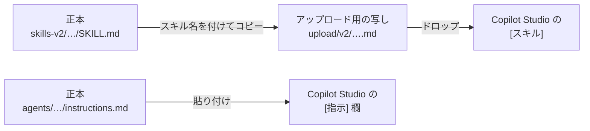

# スキル差し替え検証 手順書

## この検証で確かめること

Microsoft Copilot Studio (以下、Copilot Studio) で確かめる問いは 1 つです。**振る舞いの変更を、スキルの差し替えだけで完結できるか**。

> [!NOTE]
> **この検証は完了しました。結論は「成立する。ただし、確実に利用者まで届くのはハブのスキル」です。** 部門にしかないスキルも、ハブから呼ばれたときに使われてはいます。ただし、ハブが回答を組み直すときに、その効果が落ちることがあります (検証 G)。詳細は「置いたものが利用者に届く場所、届かない場所」と「判定」を読んでください。以下の手順は、同じ検証をもう一度行うため、および同じ構成を別の環境で組むために残してあります。

口調、エスカレーション条件、部門固有の手続きの 3 つを変更します。いずれも `SKILL.md` を差し替えるだけで実現でき、どのエージェントの指示にも手を入れずに済めば合格です。1 つでも指示を編集したくなったら、その時点で**変更の中身を Copilot Studio の外に置く**構成は成立していません。

あわせて、部門を 1 つ増やす作業がハブの指示を変えずに済むかも確かめます。

### 「Copilot Studio で文面を書かない」の意味

この検証が目指しているのは、**Copilot Studio を開かないこと**ではありません。**Copilot Studio で文面を書かないこと**です。両者は違います。

エージェント スキルを更新する経路は、Copilot Studio の画面しかありません。手元の `SKILL.md` を直しても、誰かが画面で上げ直すまで反映されません。したがって「開かずに完結」は成立しません。

成立するのはこちらです。

| 変更の種類 | 中身を決める場所 | Copilot Studio での作業 |
| --- | --- | --- |
| 知識を足す、直す | SharePoint の `published` | なし |
| 振る舞いを変える | 手元で管理する `SKILL.md` | ファイルを差し替えるだけ |
| 部門を増やす | 手元で管理する指示と説明文 | エージェントの作成、接続、公開 |
| あいさつ文を変える | **なし (正本に置けない)** | **設定画面に直接書く** |

文面を考えて打ち込む作業は手元の正本 (「0-3 正本を置く場所を用意する」を参照) と SharePoint に寄せ、Copilot Studio 側には機械的な手数だけを残す。これが守れているかを測ります。

最後の 1 行が例外です。あいさつ文だけは正本に置けません。理由は検証 E に書きました。

### 置いたものが利用者に届く場所、届かない場所

**検証を終えて判明した、いちばん重要なことです。先に読んでください。**

ハブ エージェントは、接続先の部門エージェントから受け取った回答を、**自分のスキルで組み立て直します。** ハブの指示に「接続先から受け取った内容をそのまま伝えてください」と書いてあっても、そうはなりません。日数や条文番号といった事実は保たれますが、文体と体裁はハブ側が決めます。

| 置いた場所 | 利用者が部門エージェントに直接聞いたとき | 利用者がハブに聞いたとき |
| --- | --- | --- |
| ハブのスキル | 該当なし | **効く** |
| ハブの指示| 該当なし | 効く (ただし体裁はハブのスキルが優先) |
| 部門にしかないスキル | 起動することがある (C では起動し、E-03 の `hr-tone` では起動しなかった) | **使われるが、ハブが組み直すときに落ちることがある** (検証 G) |
| 部門の指示| **効く** | **効かなかった** (※) |
| 部門のナレッジ ソース | 効く | **効く** (事実は保たれる) |

表は 2026 年 9 月から 10 月の実測です。
※ 部門の指示は、検証 E-03 で人事の指示を変えた後、**[保存]** だけで試しました。人事エージェントは公開し直していません。検証 G で、ハブの **[プレビュー]** は部門の公開版を呼ぶことが分かりました (2026 年 10 月)。変更前の人事が呼ばれていた可能性が高いため、この行は「指示がハブで消された」証拠にはなりません。

部門にしかないスキルの行は、検証 F と G で分かったことです。

- 検証 F (2026 年 10 月 3 日) では、`description` を限界まで強く書いた部門のスキルも、ハブ経由では 9 回とも整理番号が出ませんでした。
- 検証 G (2026 年 10 月 19 日から 20 日、別の環境) で F を再現し、ハブの推論カードの **Used tool** で部門の回答を確かめました。部門は 9 回とも整理番号を書いて返していましたが、ハブの最終回答では 9 回とも消えていました。ハブが回答を自分の `tone-and-format` の構成に組み直すときに落としていました。
- ハブから `tone-and-format` を外すと、整理番号は 15 回中 14 回、最終回答に届きました。外していても、ハブが自分で組み直して落とす回があります。

詳細は `tests/records/検証G.md` にあります。

つまり、**ハブ + 部門エージェントという構成では、利用者に届く文面はすべてハブが決めます。** 部門側に置けるのは「事実の出どころ」だけです。

この事実から、次の 2 つが決まります。

1. **共通の体裁を変えるときは、ハブのスキルだけを差し替えます。** 部門エージェントは触りません。部門が何個に増えても作業は 1 か所です。
2. **部門ごとに振る舞いを変えたいときも、ハブのスキルに書きます。** 共通スキルの中に「部門ごとの」節を設け、部門固有の記述はその節の中だけに閉じます。部門エージェント側にスキルを置くと、部門では使われますが、ハブが回答を組み直すときに落ちることがあります。確実に届けたいことはハブのスキルに書きます。

2 の結果として、共通スキルに部門名が入ります。「ハブに部門名を書かない」という当初の設計方針は、この一点で崩れます。ただし崩れるのは指示ではなくスキルなので、正本を外に置く形そのものは保てます。

> [!IMPORTANT]
> 検証中に指示を編集したくなったら、編集する前に何を書きたかったかを記録シートに書いてください。記録が残らないと、この検証は「うまくいかなかった」以上の情報を生みません。

## 前提

| 項目 | 内容 |
| --- | --- |
| ハーネス | GitHub Copilot ハーネス |
| 環境 | Power Platform 環境 1 つ。部門ごとに分けない |
| 権限 | エージェントを作成、公開できる権限。SharePoint の部門フォルダーに書き込める権限 |
| チャネル | 検証中は **[プレビュー]** タブのみ。公開は検証 D の前に 1 回だけ行う |
| 所要時間 | 準備とベースラインで半日。検証 A から E で半日 |
| 公開 | 部門エージェントは接続の前に公開が必要 (1-4 を参照)。ハブの公開は接続後でよい |
| 課金 | 構築、テスト、評価も Copilot クレジットを消費します。開始前に消費量の見方を確認してください |

UI のラベルは日本語環境の実画面の表記です。エージェントのオーサリング面は **[作成]**、**[プレビュー]**、**[評価]**、**[監視]** の 4 タブで、右側の構成パネルに **[チャネル]**、**[スキル]**、**[ツール]**、**[ナレッジ]**、**[接続されたエージェント]**、**[メモリ]** が並びます。各項目の **[+]** から追加します。英語環境では **[作成]** が **[Build]**、**[スキル]** が **[Skills]** に当たります。

エージェントの動作は、**[作成]** タブの中央にある **[指示]** 欄に書きます (英語の UI では **[Instructions]**)。この手順書で「指示」と書いているのはこの欄のことです。

モデルの既定は Claude Opus 5 でした。**[メモリ]** はプレビュー機能です。

## 検証キットの中身

| 場所 | 中身 | 使いどころ |
| --- | --- | --- |
| `agents/*/instructions.md` | ハブと 3 部門の指示 | フェーズ 1 と検証 D |
| `agents/*/description.md` | 接続エージェントの説明文 | フェーズ 1 と検証 D |
| `skills/` | 共通スキル 3 つの原稿。v1 (差し替え前) | 正本の管理とレビュー |
| `skills-v2/` | v2。検証 A から D で使用 | 正本の管理とレビュー |
| `skills-v3/` | v3。E-01 と E-03 の途中経過。`hr-tone` を含む | 正本の管理とレビュー |
| `skills-v4/` | v4。運用で使う版。`hr-tone` は廃止 | 正本の管理とレビュー |
| `upload/v1/` から `upload/v4/` | 各版をスキル名の `.md` にしたもの | アップロードはここから |
| `tests/records/` | 検証 A から G の詳細記録 | 結果の見直し |
| `tests/検証F-計画.md` | 検証 F の設計と手順 | 検証 F |
| `skills-f/`、`upload/f/` | 検証 F の目印のスキル。運用には使わない | 検証 F |
| `tests/records/検証G.md`、`tests/eval_F再現.csv` | 検証 G の記録と、[評価] タブに取り込んだテスト セット | 検証 G |
| `README-versions.md` | スキルの版 v1 から v4 の対応表 | どの版を使うかの確認 |
| `knowledge/hr/` | 人事の文書 3 点 (docx 2 点、pdf 1 点) | フェーズ 0 |
| `knowledge/soumu/` | 総務の文書 3 点 (docx 2 点、pdf 1 点) | フェーズ 0 |
| `knowledge/it/` | 情シスの文書 2 点 (docx) | 検証 D |
| `knowledge/_xlsx-参考/` | 同じ表を xlsx にしたもの | 登録しない (下の CAUTION を参照) |
| `knowledge-src/` | 文書の原稿 (Markdown と CSV) | 文書を直すとき |
| `tests/検証テストセットと記録シート.xlsx` | 質問、変更依頼、記録欄、判定表 | 全フェーズ |
| `scripts/build_knowledge.py` | 原稿から docx、xlsx、pdf を作り直す | 文書を直したとき |
| `scripts/build_testbook.py` | 原稿から検証ブックを作り直す | テストセットを直したとき |
| `figures/` | 実画面のスクリーンショット | 手順の確認 |

文書は意図的に作り込んであります。所管が重なるテーマ (在宅勤務、社員証、PC の持ち出し) と、どこにも書いていない事項 (育児休業の延長) を混ぜてあります。前者は振り分けの、後者はエスカレーションの検証に使います。

## フェーズ 0: 準備

### 0-1 SharePoint に部門フォルダーを作る

1. 検証用のサイトのドキュメント ライブラリで **[作成またはアップロード]** > **[フォルダー]** を選び、`人事`、`総務`、`情報システム` の 3 フォルダーを作ります。
2. 各フォルダーの下に `published` フォルダーを作ります。エージェントに登録するのはこの `published` だけです。
3. 作業中の文書を置く `作業中` フォルダーも作ります。こちらは登録しません。

### 0-2 文書を置く

1. `knowledge/hr/` の 3 ファイルを `人事/published` に置きます。
2. `knowledge/soumu/` の 3 ファイルを `総務/published` に置きます。
3. `knowledge/it/` の 2 ファイルは、まだ置きません。検証 D で使います。
4. 各ファイルのタイトル プロパティが入っていることを確認します。SharePoint の一覧で **[タイトル]** 列を表示すると見えます。

> [!CAUTION]
> **数値の表を xlsx で置かないでください。** SharePoint をナレッジ ソースにする経路はセマンティック検索で、Excel のセルを引けません。Microsoft Learn にも「Excel の内容を検索するにはセマンティック検索ではなくコード インタープリターを使うこと。セマンティック検索にはセル単位のインデックスに制約がある」と明記されています。キットでは付与日数表と貸与備品一覧を docx にしてあります。xlsx 版は `knowledge/_xlsx-参考/` に残していますが、`published` には置きません。

> [!NOTE]
> タイトルは、エージェントが参照先を選ぶときの手がかりの 1 つです。キットのファイルには設定済みですが、以後この検証で文書を足すときも必ず入れてください。空のまま置くと、その文書だけ拾われない事象が起きます。

置き終えると、`人事/published` と `総務/published` に、それぞれ 3 ファイルが並びます。

### 0-3 正本を置く場所を用意する

スキルの `SKILL.md` と、エージェントの指示の文面は、Copilot Studio の画面では書きません。
手元のフォルダーに *正本* (内容を直すときに手を入れる、ただ 1 つの原本) を置き、直すときは正本を直します。
Copilot Studio に上げるのは、正本から作った写しです。
Copilot Studio の画面 (たとえば **[指示]** 欄) や写しを直接直すと、その変更は正本に入りません。
次に正本から上げ直したときに上書きされて消え、画面には編集の履歴も残らないため、何が消えたのかも分かりません。

正本はどれもファイル名が `SKILL.md` なので、ドロップするときに見分けやすいよう、スキル名を付けた写しを `upload/` に置いています。
中身は正本と同じで、`scripts/build_upload.py` でまとめて作り直せます。

正本を置く場所を決めます。

1. `skills/` と `skills-v2/` をそのまま置きます。
2. `agents/` も置きます。指示と説明文の変更履歴を残すためです。
3. **この検証では、版ごとにフォルダーを分けて (`skills/`、`skills-v2/` …) 版を残しました。** 公開にあたってキットを GitHub のリポジトリにしたので、これからの変更はコミットの履歴でも追えます。

#### 置き場所に求めること

**特定の製品は要りません。** 次の 3 つが満たせれば何でもかまいません。

| 求めること | なぜ必要か |
| --- | --- |
| 差分が見えること | 「口調が変わったのはどの 1 行か」を後から示せます。Copilot Studio の画面にはスキルの編集履歴が残らないので、差分は置き場所にしかありません |
| 前の版に戻せること | 差し替えたスキルが期待と違ったとき、戻す先が要ります。画面で直接編集すると戻せません |
| 変更依頼を受けてから反映する経路があること | 運用を部門に渡すときに要ります。依頼を受け、確認し、それからアップロードする流れです |

版ごとのフォルダーでも Git でも、この 3 つは満たせます。**特定の仕組みである必要はありません。** 版が残るファイル共有でも成立します。検証の合格条件は「指示を編集していないこと」なので、**編集していないことを記録で示せる**状態であれば十分です。

> [!NOTE]
> Copilot Studio の画面でスキルを直接編集できる場合もあります。ただしそれをやると、何をいつ変えたかがどこにも残りません。この検証では画面で編集せず、置き場所を直してから差し替えます。

## フェーズ 1: ベースラインを作る

### 1-1 部門エージェントを作る

人事と総務の 2 つを作ります。情シスはまだ作りません。

1. Copilot Studio で新しいエージェントを作ります。名前は `人事エージェント` とします。
2. `agents/hr/instructions.md` の区切り線より上を、指示に貼ります。
3. 同じ手順で `総務エージェント` を作り、`agents/soumu/instructions.md` を貼ります。

*図 1-1 新しいエージェントの初期画面。右側が構成パネル、指示欄には雛形が入っている* 
Used with permission from Microsoft.

*図 1-2 雛形を選択して置き換えたところ* 
Used with permission from Microsoft.

### 1-2 ナレッジ ソースを登録する

最初に、既定で入っている Web 検索のソースを外します。**[ナレッジ]** に「すべての Web サイトを検索する」のチップがあるので、**[×]** で削除します。これを残すと、登録文書に根拠がない質問に Web から答えてしまい、検証 B-03 が成立しません。

1. 人事エージェントの **[作成]** タブ右側の **[ナレッジ]** の **[+]** を選びます。
1. **[SharePoint]** を選びます。
1. SharePoint で `人事/published` を開き、**[リンクのコピー]** で URL を取得して貼り付け、**[追加]** を選びます。
1. 表に行が追加されたら、**[名前]** と **[説明]** を書き換えます。既定の説明は「このドキュメント ライブラリは...」という汎用文で、振り分けの手がかりになりません。
1. **[エージェントに追加する]** を選びます。
1. 総務エージェントにも同じ手順で `総務/published` を登録します。

名前と説明の例を挙げます。

| 項目 | 人事 | 総務 |
| --- | --- | --- |
| 名前 | 人事の規程と通達 | 総務の規程と要領 |
| 説明 | 人事が公開している規程、通達、別表。年次有給休暇の付与日数と取得単位、繰越、退職時の取扱い、通勤手当の上限と在宅勤務日の扱い、勤怠、社会保険、入退社手続きの根拠が入っている。 | 総務が公開している規程と要領。会議室の予約と利用時間の上限、優先順位、貸与備品の申請区分と自宅への持ち出しの可否、社員証の紛失時の連絡と再発行手数料、一時入館証の根拠が入っている。 |

> [!CAUTION]
> URL を手で組み立てないでください。SharePoint の **[共有]** > **[リンクのコピー]** で取得して貼り付けます。URL の中の日本語は `%E7%B7%8F` のような記号の列で表されるため、手で組み立てると字の取り違えに気づけません。たとえば `総` (`%E7%B7%8F`) が `總` (`%E7%B8%BD`) になっていると、フォルダーは存在するのに「この項目が見つかりませんでした」と表示され、原因の切り分けに時間を取られます。

*図 1-3 **[ナレッジの追加]**。**[おすすめ]** に SharePoint がある* 
Used with permission from Microsoft.

*図 1-4 URL を貼って **[追加]** を押す前の状態* 
Used with permission from Microsoft.

URL を **[追加]** すると、下に **[リンク]**、**[名前]**、**[説明]** の 3 列の行が 1 つ増えます。**[名前]** と **[説明]** を上の表のように書き換えてから、**[エージェントに追加する]** を押します。

> [!NOTE]
> この手順の画面は、テナントのドメインが写り込んでいるため載せていません。

### 1-3 スキルを登録する

アップロードできるのは、YAML フロントマター (ファイルの先頭の `---` で挟んだ部分) と Markdown の本文 (エージェントに守らせる手順や決まり) を持つ `.md` ファイルか、`SKILL.md` を含む zip です。今回のスキルは `SKILL.md` 1 枚だけなので `.md` で十分で、この検証も最後まで `.md` だけで実施しました。`upload/v1/` に `tone-and-format.md` のようにスキル名で置いてあります。

> [!NOTE]
> Copilot Studio はフロントマターの `name` でスキルを識別します。ファイル名では識別しません。3 つのスキルはどれも中身が `SKILL.md` ですが、同じエージェントに問題なく共存します。`upload/` でファイル名を分けているのは、Finder からどれを掴むかを分かりやすくするためだけです。
>
> zip は、スクリプトやテンプレートなどの補助ファイルを同梱したいときの形式です。今回は不要なので出していません。必要になったら `scripts/build_upload.py` に足してください。

1. **[作成]** タブ右側の **[スキル]** の **[+]** を選び、**[スキルの追加]** ダイアログで **[スキルのアップロード]** タブを使います。
1. `upload/v1/tone-and-format.md` をドロップします。
1. ダイアログが閉じ、Copilot Studio がファイルを確認する処理 (「スキルを検証しています」と表示されます) が走ります。パネルにチップが増えるまで待ちます。
1. **[+]** を押し直し、`escalation-rules.md` を同じ手順で入れます。人事にはさらに `hr-leave-procedure.md` も入れます。
1. 総務エージェントとハブには `tone-and-format` と `escalation-rules` の 2 つだけを入れます。`hr-leave-procedure` は人事専用です。ハブに入れると、人事に取り次がずに自分で有給の手順を語り始める恐れがあります。

> [!IMPORTANT]
> 1 回のドロップで登録できるのは 1 件だけです。落とすとダイアログが閉じます。検証の完了を待たずに次のダイアログを開くと、開いた直後に勝手に閉じることがあります。チップが増えたのを確認してから次に進んでください。

*図 1-5 **[スキルの追加]**。ドロップ ゾーンと **[ファイルの要件]** が示される* 
Used with permission from Microsoft.

*図 1-6 1 件入るとチップが出る。ダイアログは閉じている* 
Used with permission from Microsoft.

*図 1-7 人事エージェントに 3 件そろえたところ* 
Used with permission from Microsoft.

### 1-4 部門エージェントを公開する

**接続エージェントにできるのは、公開済みのエージェントだけです。** 下書きのままのエージェントは、ハブの **[接続されたエージェントの追加]** の一覧でグレー表示になり、選択できません。ダイアログにも「エージェントを公開して接続します。以下のエージェントはまだ下書きであるため、現時点では選択できません」と出ます。

1. 人事エージェントを開き、右上の **[公開]** を選びます。
1. 確認ダイアログの **[エージェントの公開]** を選びます。チャネルは設定しなくてかまいません。
1. 総務エージェントについても同じ手順を行います。
1. 一覧の **[状態]** が **[ドラフト]** から変わるのを待ちます。

ハブ自体の公開は、接続と説明文の設定が済んでからで十分です。

### 1-5 ハブ エージェントを作る

1. 新しいエージェントを作ります。名前は `社内問い合わせ窓口` とします。
1. `agents/hub/instructions.md` の区切り線より上を、指示に貼ります。
1. **[ナレッジ]** の「すべての Web サイトを検索する」を削除します。
1. `tone-and-format` と `escalation-rules` の 2 つを入れます。
1. **[保存]** します。

### 1-6 接続エージェントとして接続する

1. ハブの **[作成]** タブ右側の **[接続されたエージェント]** の **[+]** を選びます。
1. 人事エージェントを選び、説明に `agents/hr/description.md` の本文を貼ります。
1. 総務エージェントについても同じ手順を行います。
1. この時点でハブの指示を触っていないことを確認します。

*図 1-8 ハブの完成形。ナレッジは持たせず、接続エージェントに総務と人事が並ぶ* 
Used with permission from Microsoft.

### 1-7 ベースラインを記録する

1. **[プレビュー]** タブで、テストセットの `BL-01` から `BL-12` を順に投げます。
2. 回答の要点を記録シートに写します。全文は不要です。判定の観点に対する答えだけ書きます。
3. 期待どおりにならない質問があっても、ここでは直しません。ベースラインは「今の状態」を残すためのものです。
4. `BL-10` は情シスが未接続なので、所管外の扱いになるのが期待どおりです。

> [!TIP]
> 期待した接続先が呼ばれないときは、**[プレビュー]** の推論ログ (回答の上の **Thought for N seconds**) を開き、どの接続先が呼ばれたかを見てください。原因はたいてい説明文の重なりか、領域の書き足りなさです。ここで説明文を直した場合は、直した内容を記録シートの備考に残します。

## スキルの差し替え方

検証 A から C で共通の手順です。

1. スキルのチップの **[×]** を選びます。確認ダイアログが出るので **[削除]** を選びます。
2. **[スキル]** の **[+]** から v2 のファイルをドロップします。
3. **[保存]** します。

> [!IMPORTANT]
> **[スキルの追加] は 1 回に 1 ファイルしか受け付けません。** 2 つのファイルを同時にドロップすると 1 つしか取り込まれず、**エラーも警告も出ません。** 気付かずに保存すると、片方が入っていないまま進みます。追加したら、必ずチップの数と名前を目で確認してください。

> [!NOTE]
> **どのエージェントを差し替えるか。** 検証を終えた時点の結論は「**ハブだけ**」です。部門エージェントのスキルは、利用者に届くとは限りません (「置いたものが利用者に届く場所、届かない場所」を参照)。
>
> 下の検証 A から C の手順には 3 エージェントを差し替えるように書いてあります。これは検証当時の手順で、その差が結果を分けたことを記録に残すために残してあります。**同じ構成を運用で組むときは、ハブだけを差し替えてください。**

> [!IMPORTANT]
> **この環境のビルドには、1 手で置き換える機能がありません。** スキルのチップを開くと詳細が出ますが読み取り専用で、ボタンは **[ダウンロード]** と **[閉じる]**、それとファイル名の横の目のアイコンだけです。削除の確認ダイアログにも「削除した後に再利用するには、もう一度アップロードする必要があります」と出ます。
>
> Microsoft Learn には **[...]** > **[置き換え]** の手順が載っています。ロールアウトの差と思われます。**[...]** が出てくる環境では、削除せずにそちらを使ってください。

> [!NOTE]
> 削除の確認ダイアログには「この変更は、エージェントを再公開するまでエンド ユーザーには表示されません」とも出ます。そのエージェント自身の **[プレビュー]** で見る分には **[保存]** が必要で、公開は不要です。
>
> ハブの **[プレビュー]** から部門エージェントの変更を確かめるときは、**部門エージェントを公開してから**試します。ハブのプレビューは、部門の下書きではなく公開版を呼びます (検証 G で確認、2026 年 10 月時点)。GitHub Copilot ハーネスのドキュメントには書かれていません。検証 A から C と E-03 では部門を **[保存]** だけで試し、検証 F と G では公開してから試しています。

## 検証 A: 口調をスキルだけで変える

変更依頼は「回答を結論、根拠、次にすることの 3 部構成にし、値の一覧は表で示したい」です。

1. ハブ、人事、総務の 3 エージェントで、`tone-and-format` を `upload/v2/tone-and-format.md` に差し替えます。差し替えの手順は下の IMPORTANT を参照してください。差し替えたら **[保存]** します。
2. 指示は開きません。
3. テストセットの `A-01` から `A-04` を投げ、記録シートに書きます。
4. 「スキルだけで実現できたか」と「指示を編集したか」を埋めます。

合格の条件は、差し替え前後で体裁が変わり、事実の中身が変わっていないことです。日数や金額が変わっていたら、それはスキルが事実に干渉しています。記録シートの備考に書いてください。

## 検証 B: エスカレーション条件をスキルだけで変える

変更依頼は「退職や懲戒に関わる質問は答えさせず、引き継ぎ先をメールに変えたい」です。

1. 先に `B-01` を投げ、現在の回答を記録します。この時点では規程を根拠に答えるはずです。
2. 3 エージェントで `escalation-rules` を `upload/v2/escalation-rules.md` に差し替え、**[保存]** します。
3. `B-01` から `B-04` を投げ、記録シートに書きます。

見るところは 3 つです。

- `B-01` が回答から引き継ぎに変わったか。
- `B-02` の引き継ぎ先が Teams からメールに変わり、社員番号の記載が増えたか。
- `B-04` が引き継がれずに答えられたか。ここが引き継がれたら、条件が広すぎます。

## 検証 C: 部門固有の手続きをスキルだけで変える

変更依頼は「有給の問い合わせでは、基準日と繰越の有無を先に確認し、内訳を表で示したい」です。

1. 先に `C-01` と `C-02` を投げ、現在の回答を記録します。
2. 人事エージェントで `hr-leave-procedure` を `upload/v2/hr-leave-procedure.md` に差し替え、**[保存]** します。ハブと総務は触りません。
3. `C-01` から `C-04` を投げ、記録シートに書きます。

`C-02` は計算が要ります。2022 年 4 月入社であれば、付与日は 2022 年 10 月、2023 年 10 月、2024 年 10 月、2025 年 10 月です。今日時点で有効な付与は 2025 年 10 月の分です。規程第 3 条と第 1 表を正しく引けているかを見てください。日数が違っていた場合、原因が規程の読み違いなのかスキルの手順なのかを切り分けて記録します。

## 検証 D: 部門をハブを触らずに増やす

**順序を守ってください。** 保存しただけではハブの接続候補に出ません。

1. `情報システム` フォルダーに `published` を作ります。**[作成またはアップロード]** > **[フォルダー]** です。
2. `knowledge/it/` の 2 ファイルを `情報システム/published` に置きます。
3. `情報システム エージェント` を新規作成し、`agents/it/instructions.md` を貼ります。
4. **[ナレッジ]** に既定で入っている「すべての Web サイトを検索する」を削除します。
5. `情報システム/published` をナレッジ ソースとして登録します。
6. `upload/v2/` の `tone-and-format.md` と `escalation-rules.md` を、**1 つずつ** 入れます。
7. **[保存]** します。
8. 情報システム エージェントを **[公開]** します。公開しないとハブから接続できません。
9. ハブで接続エージェントとして追加し、説明に `agents/it/description.md` の本文を貼ります。
10. ハブを **[保存]** します。
11. `D-01` から `D-05` を投げ、記録シートに書きます。

> [!IMPORTANT]
> **ナレッジ ソースの URL にスペースを含めると「URL が無効です」で弾かれます。** `Shared Documents` を `Shared%20Documents` のようにエンコードすると通ります。ブラウザーのアドレス バーからコピーしたエンコード済み URL を貼るのが確実です。日本語のフォルダー名はエンコードしなくても通りました。

合格の条件は 2 つです。ハブの指示を 1 文字も編集していないこと。そして `D-05` の振り分けが、部門を足す前と変わっていないことです。

`D-04` は情シスと総務の両方に関わります。ハブが両方に取り次いで部門ごとに分けて示せば期待どおりです。片方しか答えない場合は、説明文の除外の書き方を見直す余地があります。

## 検証 E: 境界を特定する

ここは合否ではなく、線を引くための検証です。`tests/change-requests.csv` の 3 件を順に試します。

1. `E-01` はスキルで実現できるはずです。`tone-and-format` に 1 行足して差し替え、全部門に反映されるかを見ます。
2. `E-02` と `E-03` は、実現できるかどうかも含めて分かっていません。まずスキルで試し、できなければどこを編集すれば実現できたかを記録します。
3. 3 件とも、実現できた場所と実現できなかった理由を記録シートに書きます。

この 3 行が、設計上いちばん価値のある記録になります。「スキルで吸収できる変更」と「できない変更」の境界が分かれば、次に何を指示に残すかが決まります。

## 検証 F: スキルの起動は仕様か書き方か

検証 A から E で残った問いに答えるための検証です。
部門にしかないスキルがハブ経由で使われなかったのは、スキルの書き方 (スキル名と `description`) のせいか、接続エージェントの仕組みのせいかを確かめます。

計画と手順は `tests/検証F-計画.md`、記録は `tests/records/検証F.md` にあります。
使うスキルは `skills-f/` に、ドロップするファイルは `upload/f/` にあります。

## 検証 G: 取り次ぎ先で何が起きているかを見る

検証 F の「9 回中 0 回」が、部門のスキルが読まれていないためか、読まれたがハブが落としたためかを切り分けた検証です。あわせて、ハブの **[プレビュー]** が部門の下書きと公開版のどちらを呼ぶかを確かめました。別の環境で、検証 F と同じ指示、スキル、文書、モデルのエージェントを組んで行っています。

| 段 | 確かめたこと | 結果 |
| --- | --- | --- |
| G-1 | ハブのプレビューが呼ぶのは部門の下書きか公開版か | 公開版。保存だけの変更はハブ経由に届かない |
| G-2 | 検証 F の再現 | 部門は 9 回とも整理番号を返し、ハブの最終回答では 9 回とも消えた |
| G-3 | ハブから `tone-and-format` を外す | 整理番号は 15 回中 14 回届いた |

記録は `tests/records/検証G.md` にあります。[評価] タブと App Insights で同じ現象を測った結果も、同じファイルにあります。

## 実施記録

**検証 A から E まですべて実施しました。** この節は実施の記録です。次の環境で一から始めるときは読み飛ばしてかまいません。

### 構築した環境

| 項目 | 値 |
| --- | --- |
| テナント | 検証専用のテナント |
| 環境 | 既定環境 |
| SharePoint サイト | 検証用の SharePoint サイト |
| フォルダー | `ドキュメント/問い合わせ検証/` の下に `人事`、`総務`、`情報システム`。3 つとも `published` を作成済み |

### エージェントの状態 (検証終了時点)

| エージェント |指示| スキル | ナレッジ | 接続 | 状態 |
| --- | --- | --- | --- | --- | --- |
| 社内問い合わせ窓口 (ハブ) | 投入済み | `tone-and-format` (v4)、`escalation-rules` (v2) | なし (意図どおり) | 人事、総務、情報システム | 保存済み |
| 人事エージェント | 投入済み + 文体の指示 | `tone-and-format`、`escalation-rules`、`hr-leave-procedure`、`hr-tone` | 人事の規程と通達 | なし | 公開済み |
| 総務エージェント | 投入済み | `tone-and-format`、`escalation-rules` | 総務の規程と要領 | なし | 公開済み |
| 情報システムエージェント | 投入済み | `tone-and-format`、`escalation-rules` | 情報システムの規程と手順 | なし | 公開済み |

4 エージェントとも、既定で入っていた「すべての Web サイトを検索する」は削除済みです。モデルはいずれも Claude Opus 5 です。

ハブのあいさつ文は E-02 で次のように変更しました。

> 社内問い合わせ窓口です。人事、総務、情報システムに関するご質問にお答えします。ご用件をどうぞ。

> [!NOTE]
> 人事エージェントの `hr-tone` と指示の文体指示は、E-03 の検証過程で入れたものです。**ハブ経由では効きませんでした** (指示のほうは、人事を公開し直さずに試した結果です。スキルのほうは、人事では使われていた可能性があります。冒頭の表の注記を参照)。 同じ構成を運用で組むなら、どちらも入れずに、共通スキルの `## 部門ごとの文体` の節だけで済みます。

### 置いた文書

| フォルダー | 文書 |
| --- | --- |
| `人事/published` | `年次有給休暇規程.docx`、`年次有給休暇付与日数表.docx`、`通勤手当支給細則.pdf` |
| `総務/published` | `会議室利用規程.docx`、`貸与備品一覧.docx`、`社員証取扱要領.pdf` |
| `情報システム/published` | `業務用PC貸与および持出基準.docx`、`アカウント公開削除手順と権限一覧.docx` |

ベースラインは xlsx 版で実施し、`BL-03` と `BL-09` だけ docx 版で再実行しました。上の表は差し替え後の構成です。情報システムの 2 点は最初から docx で置きました。

### ベースラインの記録 (2026 年 9 月 22 日)

ハブの **[プレビュー]** から 1 問ずつ、質問ごとに **[新しいチャット]** で投げました。文脈を持ち越すと `BL-12` の聞き返しが成立しないためです。

テストセットは各部門 3 問に整理しました。`BL-02`、`BL-04`、`BL-07` は他の問いと内容が重なるためベースラインから外し、参考記録として残しています。9 問の内訳は、人事、総務、所管外がそれぞれ 3 問、各部門で docx の条文、xlsx の表、pdf の数値が 1 つずつ当たるようにしました。

| ID | 根拠の形式 | 振り分け | 判定 | 要点 |
| --- | --- | --- | --- | --- |
| BL-01 半日単位 | docx | 人事 | 合格 | 午前と午後の区分を落とさずに回答 |
| BL-03 比例付与 | docx (当初 xlsx) | 人事 | 合格 | 第 2 表の週 3 日の行を表で提示。当初は xlsx で不合格 |
| BL-05 通勤手当 | pdf | 人事 | 合格 | 月額 50,000 円と自己負担を正答。引用番号付き |
| BL-06 会議室 | docx | 総務 | 合格 | 3 時間以内、部門長の承認で超過可。引き継がずに回答 |
| BL-08 再発行手数料 | pdf | 総務 | 合格 | 1,000 円と翌月給与控除、減免規定も回答 |
| BL-09 モニター貸与 | docx (当初 xlsx) | 総務 | 合格 | 申請区分、貸与期間、持ち出しの可否を回答。当初は xlsx で不合格 |
| BL-10 PC の持ち帰り | なし | 総務 | 保留 | 総務に取り次いだが、末尾に情シス所管で取り次げないと明記 |
| BL-11 交通費の精算 | なし | なし | 合格 | 所管する接続先がないと述べ、通勤手当か経費精算かを聞き返す |
| BL-12 手続き一般 | なし | なし | 合格 | 推測で部門を選ばず聞き返す |

参考記録の 3 問は、`BL-02` が付与日数 (xlsx を取得できず引き継ぎ)、`BL-04` が 30 分の中抜け (1 時間未満は年休扱いにしないと正答)、`BL-07` が社員証の紛失 (当日中の連絡までを正答) です。

### ベースラインで分かったこと

**xlsx を根拠とする 3 問すべてで、表の内容を取得できないという回答になりました。** 人事と総務の両方で再現しています。docx と pdf は正しく引けており、pdf は引用番号まで付きました。

原因は設定ではなく仕様です。SharePoint をナレッジ ソースにする経路はセマンティック検索で、Microsoft Learn に「Excel の内容を検索するにはセマンティック検索ではなくコード インタープリターを使うこと。セマンティック検索にはセル単位のインデックスに制約がある」と明記されています。あわせて「xlsx を追加できるが、エージェントはコードを実行できないため分析的な質問への回答は最適にならない場合がある」とも書かれています。

> [!IMPORTANT]
> **対応済みで、効果も確認しました。** 付与日数表と貸与備品一覧を docx で作り直して `published` を差し替え、`BL-03` と `BL-09` を再実行したところ、どちらも表の値を引いて回答するようになりました。`BL-03` は第 2 表の週 3 日の行 (6 か月 5 日から 6 年 6 か月以上 11 日) を表で提示し、`BL-09` は申請区分「所属長承認」、貸与期間「1 年 (更新可)」、持ち出し「可」を回答しました。xlsx 版は `knowledge/_xlsx-参考/` に残してあります。
>
> なお、インデックスは数分で終わりました。Microsoft Learn の記載は同期間隔が 4 時間から 6 時間ですが、置き直した直後に反映されることもあります。

ほかに 2 点あります。

1. **回答が長い。** 1,000 字を超えるものが多く、`tone-and-format` v1 が想定する 200 字から 400 字を大きく超えています。検証 A は字数ではなく見出しの有無で判定し、字数は実測を備考に残してください。
2. **ハブの案内範囲が揺れる。** `BL-11` では取り次げる範囲に未接続の情報システムを挙げ、`BL-12` では挙げませんでした。ハブの指示に 3 部門が書かれているためです。検証 D の判定は案内文ではなく `D-05` の振り分け結果で見てください。

詳細は検証ブックの **[所見]** シートにあります。

### 検証 A から E の記録 (2026 年 9 月 22 日から 23 日)

#### 検証 A 口調: 合格 (条件付き)

`tone-and-format` を v2 に差し替え、`A-01` から `A-04` を投げました。**4 問中 2 問でのみ 3 見出しが出ました。** `A-01` と `A-04` は合格、`A-02` と `A-03` は表は出たものの独自の見出しになりました。

`A-02` と `A-03` では、推論ログに `Loading skill:` が出ませんでした。使われなかったのはハブ自身の `tone-and-format` です。なぜ使われなかったのかは、この時点では分かっていません。

#### 検証 B エスカレーション: 合格 (条件付き)

`escalation-rules` を v2 に差し替え、ハブ、人事、総務の 3 つに入れました。

| ID | 質問 | 起動したスキル | 結果 |
| --- | --- | --- | --- |
| B-01 | 退職日までに有給を使い切れない | `search-before-answer`、`escalation-rules` | 合格 |
| B-02 | 社員証の再発行手数料を免除してほしい | `escalation-rules` | 合格 |
| B-03 | 育児休業を延長できるか | **なし** | **不合格** |
| B-04 | 有給は半日単位で取れるか (対照) | `tone-and-format` | 合格 |

`B-01` と `B-02` は v2 の文面どおりに変わりました。引き継ぎ先が Teams からメールになり、「2 営業日」と「社員番号」が入りました。`B-04` で過剰エスカレーションも起きていません。

**`B-03` だけが割れました。** 根拠なしを述べて引き継ぐところまでは想定どおりですが、引き継ぎ先が Teams のままでした。この回はハブが人事エージェントへ丸投げし、ハブ自身の `escalation-rules` が起動していません。

#### 検証 C 部門固有の手続き: 不合格 (ハブ経由) / 合格 (エージェント直接)

人事エージェントの `hr-leave-procedure` を v2 に差し替えました。

**ハブ経由では `C-01` から `C-04` の 4 問とも、`hr-leave-procedure` が起動しませんでした。** 差し替え前のベースライン 4 回と合わせて 8 回連続です。基準日も繰越も尋ねず、内訳表も出ません。

**人事エージェントに直接聞くと、v2 の手順が細部まで効きました。**

- `C-01`: `search-before-answer` → `hr-leave-procedure` → `tone-and-format` が順に起動し、入社年月、週所定労働日数、**前年度からの繰越日数**を尋ねた
- `C-02` (繰越 5 日と伝えた場合): v2 で指定した 2 列の表が出た

| 区分 | 日数 (日) |
| --- | --- |
| 当年度の付与日数 (勤続 3 年 6 か月、週 5 日) | 14 |
| 繰越日数 (申告値) | 5 |
| 合計 | 19 |

**差し替え自体は正しく反映されています。効かないのはハブ経由のときだけです。**

#### 検証 D 部門追加: 合格

情報システム エージェントを新規に作り、ハブに接続しました。**ハブの指示は一文字も変えていません。**

| ID | 質問 | 振り分け | 結果 |
| --- | --- | --- | --- |
| D-01 | 在宅勤務の日に PC を持ち帰りたい | 情シス | 合格 |
| D-02 | VPN は公衆 Wi-Fi から使えるか | 情シス | 合格 |
| D-03 | 退職するとアカウントはいつ止まるか | 情シス | 合格 |
| D-04 | 社員証と PC を同時に紛失 | 総務 + 情シス | 合格 |
| D-05 | 有給は半日単位で取れるか (対照) | 人事 | 合格 |

5 問すべて合格しました。`D-05` で既存の振り分けが崩れていないことも確認できました。`D-04` では両部門に並行して取り次ぎ、見出しを分けて返しています。

`D-03` は xlsx 問題への対応が効いたことの確認にもなりました。「最終出勤日の終業時刻」は docx 化した表から引いた値です。

#### 検証 E 境界: 合格 (E-01、E-03) / 不合格 (E-02)

**E-01 全部門の回答の末尾に受付時間を出したい: 合格**

`tone-and-format` に「受付時間」の節を追加して v3 とし、**ハブだけ**差し替えました。部門エージェントは触っていません。

| 部門 | 質問 | 末尾の受付時間 |
| --- | --- | --- |
| 人事 | 有給は半日単位で取れますか | 出た |
| 総務 | 社員証を忘れたときは | 出た |
| 情報システム | VPN は公衆 Wi-Fi から使えるか | 出た |

**共通の体裁はハブ 1 か所で管理できます。**

**E-02 あいさつ文を変えたい: 不合格 (スキルでは実現できない)**

あいさつ文は利用者が話しかける前に出ます。オーケストレーションが動いていないため、スキルが起動する余地がありません。

編集先は **[...]** > **[設定]** > **[あいさつとプロンプト]** > **[あいさつメッセージ]** です。同じ画面の **[推奨プロンプト]** も同様にスキルの管轄外です。設定ダイアログで **[完了]** を選んだあと、**[保存]** が必要です。

Microsoft Learn にも、GitHub Copilot ハーネスの設定項目として記載があります。

**E-03 人事の回答だけ丁寧な文体にしたい: 合格 (1 つの方法のみ)**

3 つの方法を試しました。

| 方法 | 人事に直接 | ハブ経由 |
| --- | --- | --- |
| 部門固有スキル `hr-tone` を人事に置く | 起動せず | 効かず |
| 人事の指示に書く | **効いた** | 効かず |
| ハブの共通スキルに部門条件を書く | 該当なし | **効いた** |

成立したのは 3 つ目だけです。`tone-and-format` に `## 部門ごとの文体` という節を設け、人事のときだけ文体を上書きすると書いたところ、人事の回答が「〜いただきますようお願いいたします」に変わり、末尾に指定の 1 文が出ました。情報システムの回答は変わっておらず、**他部門への波及もありません。**

> [!NOTE]
> 方法 1 と 2 は、人事エージェントを変更した後に **[保存]** だけで試し、公開し直していません。方法 2 のハブ経由の結果には、この条件が付きます (冒頭の表の注記を参照)。

### 検証中に判明した操作上の注意

| 事象 | 内容 |
| --- | --- |
| スキルの追加 | 1 回に 1 ファイルのみ。2 つ同時にドロップすると 1 つしか入らず、エラーも警告も出ない |
| ナレッジ ソースの URL | スペースを含むと「URL が無効です」。`Shared%20Documents` のようにエンコードする |
| 新規エージェントの既定ナレッジ | 「すべての Web サイトを検索する」が入る。社内文書だけを根拠にするなら削除する |
| ハブへの接続 | 接続先を **[公開]** しないと候補に出ない。保存だけでは不足 |
| 設定の反映 | 設定ダイアログの **[完了]** のあとに **[保存]** が必要。ダイアログを閉じただけでは反映されない |

### スキルが起動したかを確認する方法

**[プレビュー]** タブで質問を投げ、回答の上に出る推論カード (2026 年 10 月時点の見出しは **Thought for N seconds**) の中を見ます ([エージェントをテストする(GitHub Copilot)](https://learn.microsoft.com/ja-jp/microsoft-copilot-studio/agents-experience/authoring-test-bot#turn-on-debug-mode))。`Used skill: <スキル名>` という行が出ていれば起動、出ていなければ起動していません (2026 年 9 月の検証 A から E では `Loading skill:` という表記でした)。各行の **[>]** を押すと、そのスキルの中身や、`Called 2 tools` で何を呼んだかまで展開できます。

確認できない場所が 2 つあります。

- **[監視]** タブはグレーアウトしていて開けませんでした。エージェントを公開していないためと思われます (2026 年 9 月の実測)。2026 年 10 月時点の Learn では、公開前でも開けて、利用状況などのデータは公開して使われ始めてから表示されると説明されています ([Monitor agent performance overview (GitHub Copilot)](https://learn.microsoft.com/ja-jp/microsoft-copilot-studio/agents-experience/analytics-overview))。
- **[履歴]** には過去のセッションが残りますが、**開いた履歴に `Used skill:` (2026 年 9 月は `Loading skill:`) の行は残りません。** 推論カードの見出しも **アクティビティの表示** に変わります (2026 年 10 月時点)。 モデルの考えとナレッジ検索の行だけになります。

つまり、スキルの起動を見るならプレビューで投げた直後にその場で見る必要があります。

### ハブ経由で、取り次ぎ先の回答を確かめる方法

ハブの推論カードには、取り次ぎ先の部門エージェントでどのスキルが使われたかは出ません。取り次ぎ先の回答そのものは、次の方法で確かめられます (2026 年 10 月時点、検証 G で確認)。

| 方法 | 見えるもの | 見えないもの |
| --- | --- | --- |
| ハブの推論カードの **Used tool** | ハブが部門に渡した依頼 (`task`) と、部門が返した回答 (`agent_response`) | 部門で使われたスキル。**エンド ユーザー プレビュー** をオンにしていると、依頼と回答も出ない |
| 部門エージェントの **[履歴]** | ハブから呼ばれた回のセッション、依頼文、部門の回答、クレジット | `Used skill:` の行 |
| App Insights (環境レベルのテレメトリ、プレビュー) | ハブ → 部門 → ナレッジ検索のつながり、各段の入出力 | スキルの読み込み。マネージド環境が必要で、反映まで最大 24 時間 |

どの方法でも、部門でスキルが使われたかは直接は見えません。確かめたいときは、検証 F のようにスキルの本文で回答に目印を書かせます。

[評価] タブの「全般的な品質」は、部門の内容がハブで落ちていても合格と判定しました。回帰テストに使うときは、この限界を前提にします。

## 判定

検証ブックの **[判定]** シートを埋めます。

| 検証 | 合格の条件 | 結果 |
| --- | --- | --- |
| A 口調 | `tone-and-format` の差し替えだけで体裁が変わる | 合格 (条件付き) |
| B エスカレーション | `escalation-rules` の差し替えだけで条件と引き継ぎ先が変わる | 合格 (条件付き) |
| C 部門固有の手続き | `hr-leave-procedure` の差し替えだけで聞き返しと提示が変わる | 不合格 (ハブ経由) / 合格 (直接) |
| D 部門追加 | ハブを編集せずに部門が増え、既存の振り分けが変わらない | 合格 |
| E 境界 | スキルで吸収できる変更とできない変更の線が引ける | 合格 (E-01、E-03) / 不合格 (E-02) |
| **総合** | スキルを外で管理し、差し替えだけで振る舞いを変えられる | **合格 (条件付き)** |

### 総合判定

**成立します。** ただし条件が 3 つあります。

1. **変更はハブのスキルに対して行います。** 部門エージェント側にスキルを置いても利用者には届きません。
2. **部門ごとの違いも、共通スキルの中に「部門ごとの」節を設けて書きます。** その結果、共通スキルに部門名が入ります。
3. **あいさつ文だけは例外です。** 正本に置けず、Copilot Studio の設定画面に直接書きます。

A と B が「条件付き」なのは、差し替えが効かない回があったためです。B-03 は、ハブが人事エージェントに任せ、どちらでも `escalation-rules` が使われませんでした。A-02 と A-03 は、ハブ自身の `tone-and-format` が使われなかった回で、理由は分かっていません。C が「不合格 (ハブ経由)」なのは、部門にしかないスキルがハブ経由では使われないためです。**部門エージェントに置いたスキルを、ハブ経由で効かせることはできません。**

D は無条件で合格しました。ハブの指示を一文字も変えずに部門を追加でき、既存の振り分けも崩れていません。「所管の判断は接続先の説明文が担う」という設計はそのまま使えます。

### 次に決めること

この検証で境界が引けたので、次に決めるのは運用の形です。

| 決めること | 選択肢 |
| --- | --- |
| 部門ごとの振る舞いをどこに書くか | 共通スキルの「部門ごとの」節に集約する (今回採用) |
| あいさつ文を管理対象にするか | `agents/hub/greeting.md` として正本に置き、人がコピーして貼る / 管理対象から外す |
| 部門エージェントの指示をどうするか | 事実の扱い方だけを残す。文体や体裁は書いても届かないので書かない |

## 検証中に守ること

1. **事実はスキルに書かない**。日数、金額、期限はすべて文書側にあります。スキルに書くのは、どの順で確認し、どう示すかだけです。スキルに事実を書くと、文書と食い違ったときにどちらが正しいか分からなくなります。
2. **引用の形式を指示しない**。出典の表示のさせ方をスキルや指示で変えようとすると、根拠のある回答まで破棄されることがあります。
3. **正本を外に置く**。Copilot Studio の画面でスキルを直接編集しないでください。編集したくなったら、正本を直してから差し替えます。
4. **1 回の検証で 1 つだけ変える**。スキルを 2 つ同時に差し替えると、どちらが効いたのか分からなくなります。
5. **数値の表は xlsx で置かない**。docx か pdf の本文中の表にします。xlsx はセルを引けないため、体裁が変わらなかったのか文書が読めていないのかを区別できなくなります。
6. **どの経路で試したかを必ず記録する**。ハブ経由で聞いたのか、部門エージェントに直接聞いたのかで結果が変わります。片方だけ試して「効かない」と書くと、原因の切り分けができません。
7. **スキルを追加したらチップを目で確認する**。1 回に 1 ファイルしか入らず、エラーも出ません。

## つまずいたときの見どころ

| 症状 | 最初に見るところ |
| --- | --- |
| 文書が回答に使われない | ナレッジ ソースの状態。タイトル プロパティ。秘密度ラベル |
| 表の値だけ回答に使われない | その文書が xlsx になっていないか。SharePoint 経由では Excel のセルを引けません |
| 期待した部門に振られない | 接続先の説明文の重なり。除外の記述 |
| スキルが起動しない | `SKILL.md` の `description`。いつ使うかがキーワード込みで書かれているか |
| 差し替えたのに変わらない | **[保存]** したか。**[プレビュー]** は下書きを見るので保存は必要、公開は不要です。ハブ経由で部門の変更を確かめるなら、部門エージェントを公開します (ハブは部門の公開版を呼びます) |
| 回答が長すぎる、短すぎる | `tone-and-format` の字数指定と、実際に返っている文字数を数えて比べる |
| 事実が変わってしまった | スキルに事実が混ざっていないか。混ざっていれば設計の誤りです |
| 接続エージェントの一覧で選べない | 相手のエージェントを公開したか。下書きは選択できません |
| スキルを置き換えられない | このビルドに置き換え機能はありません。削除して追加し直します |
| 根拠のない質問に答えてしまう | **[ナレッジ]** に「すべての Web サイトを検索する」が残っていないか |
| 部門エージェントに入れたスキルが効かない | ハブの **Used tool** で部門の回答を見ます。部門の回答に効果が出ていれば、ハブが組み直すときに落としています。確実に届けるなら、共通スキルの「部門ごとの」節に書きます |
| 部門の指示が効かない | 部門を公開したか。検証ではハブ経由で届きませんでした (部門を公開し直さずに試した結果)。文面に関わることは共通スキルの「部門ごとの」節に書き、部門に残すのは事実の扱い方だけにします |
| スキルを 2 つ入れたのに 1 つしかない | 同時ドロップは 1 つしか取り込まれません。1 つずつ入れ直します |
| ナレッジ ソースの URL が弾かれる | スペースが入っていないか。`Shared%20Documents` のようにエンコードします |
| 接続候補にエージェントが出ない | 相手を **[公開]** したか。保存だけでは出ません |
| 設定を変えたのに反映されない | ダイアログの **[完了]** のあとに **[保存]** したか |
| あいさつ文を変えたい | スキルでは変わりません。**[...]** > **[設定]** > **[あいさつとプロンプト]** です |
| スキルが起動したか確かめたい | **[プレビュー]** の推論ログの `Used skill:` (2026 年 9 月は `Loading skill:`) を見ます。履歴には残りません |
